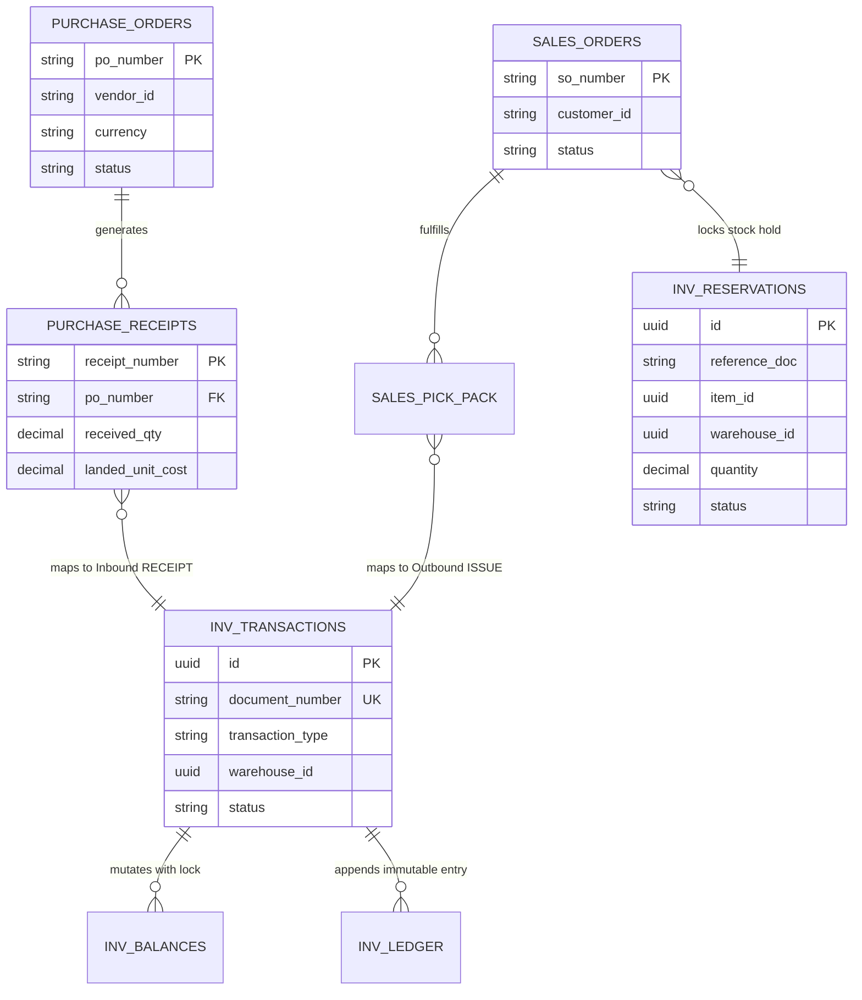

# Future Cross-Module Integration ERD

This diagram illustrates the decoupling between the **Current Production Inventory Engine** and the **Future Purchase & Sales Modules**. Integration occurs strictly through standardized contract interfaces and transactional events.

